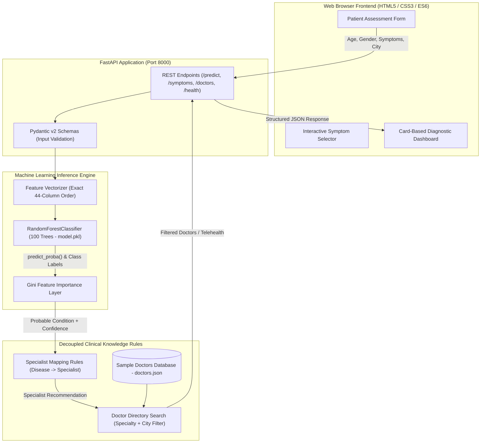
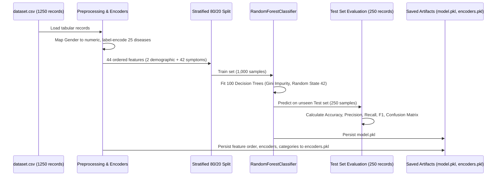

# AI Healthcare Assistance System

> **Portfolio & Educational Demonstration Project**  
> *An AI/ML-powered healthcare information web service that estimates probable medical conditions from patient symptoms, age, and gender using an authentically trained Random Forest model, with decoupled rule-based specialist recommendations and location-filtered doctor discovery.*

[](https://fastapi.tiangolo.com/)
[](https://scikit-learn.org/)
[](https://www.python.org/)
[]()

---

> [!CAUTION]
> ### Mandatory Healthcare Disclaimer
> **This application is developed strictly for educational and informational demonstration purposes as a computer science/machine learning portfolio project. It is NOT a medical device, diagnostic system, or treatment advisory tool.**
> 
> None of the outputs generated by this system should be construed as medical advice. If you or someone you know is experiencing severe pain, difficulty breathing, chest tightness, or any medical emergency, please call your local emergency services (e.g., 911, 112, 999) or visit an urgent care center immediately.

---

## Table of Contents

1. [Project Overview](#1-project-overview)
2. [Problem Statement](#2-problem-statement)
3. [Key Features](#3-key-features)
4. [System Architecture](#4-system-architecture)
5. [Machine Learning Methodology](#5-machine-learning-methodology)
6. [Educational Dataset](#6-educational-dataset)
7. [Preprocessing Pipeline](#7-preprocessing-pipeline)
8. [Why Random Forest?](#8-why-random-forest)
9. [Model Training Pipeline](#9-model-training-pipeline)
10. [Model Evaluation & Metrics](#10-model-evaluation--metrics)
11. [FastAPI Backend Service](#11-fastapi-backend-service)
12. [Modern Responsive Frontend](#12-modern-responsive-frontend)
13. [Specialist Recommendation Logic](#13-specialist-recommendation-logic)
14. [Doctor Recommendation Engine](#14-doctor-recommendation-engine)
15. [Installation & Prerequisites](#15-installation--prerequisites)
16. [Running the Application](#16-running-the-application)
17. [API Documentation & Examples](#17-api-documentation--examples)
18. [System Limitations](#18-system-limitations)
19. [Healthcare Safety & Ethics](#19-healthcare-safety--ethics)
20. [Future Improvements](#20-future-improvements)
21. [Interview Preparation Guide (Technical Q&A)](#21-interview-preparation-guide-technical-qa)

---

## 1. Project Overview

The **AI Healthcare Assistance System** is an end-to-end full-stack software application that bridges tabular machine learning with practical clinical workflows. Users input demographic factors (age, gender) and select observed symptoms through an interactive tag-based picker. A genuinely trained `RandomForestClassifier` analyzes the binary symptom vector and computes statistical disease probabilities via `predict_proba()`. 

To reflect sound clinical software design, the system strictly separates statistical prediction from downstream business rules:
- **ML Layer**: Predicts probable condition and statistical confidence.
- **Explainability Layer**: Computes symptom feature contributions using Random Forest Gini importance.
- **Clinical Rule Layer**: Maps the condition to a relevant medical specialist and triage urgency.
- **Directory Layer**: Queries sample clinics and verified doctors in the user's city or via telehealth.

---

## 2. Problem Statement

Patients frequently turn to search engines when feeling unwell, encountering uncurated medical forums that can induce unnecessary health anxiety (the "cyberchondria" effect) without providing actionable next steps. Conversely, non-technical users often lack knowledge of:
1. Which clinical domain or specialist to consult (e.g., distinguishing a Pulmonologist from an Allergist for respiratory wheezing).
2. How to systematically report symptom clusters to a healthcare provider.
3. Where local medical facilities exist for their specific suspected issue.

This project demonstrates how machine learning and deterministic clinical rule mapping can combine into a helpful, non-alarmist informational system that promotes timely, appropriate healthcare consultations.

---

## 3. Key Features

- **Genuine Machine Learning**: 100-tree Random Forest trained on 1,250 patient records covering 25 clinical conditions and 42 distinct symptom features.
- **Statistical Probabilities**: True class confidence percentages extracted directly from `predict_proba()`, not hardcoded values or arbitrary heuristics.
- **Differential Possibilities**: Surfaces the top-3 most probable conditions so users understand alternative clinical considerations.
- **Model Explainability**: Highlights which of the user's active symptoms carried the highest split importance in the decision tree forest.
- **Decoupled Specialist Mapping**: Deterministic clinical rules matching 25 conditions to specialized medical branches with urgency tiers.
- **Location-Based Doctor Filter**: Filters educational demo doctor profiles by specialty and city (New York, Chicago, San Francisco, Boston, Austin, London, Mumbai, etc.) with automatic telehealth fallback.
- **Zero-Dependency Modern UI**: Responsive, accessible, mobile-friendly interface built with vanilla HTML5, CSS3, and modern ES6 JavaScript.
- **FastAPI Core**: High-throughput REST API with Pydantic v2 data validation, CORS middleware, and automatic Swagger `/docs`.
- **Automated Test Suite**: 12 automated unit and integration tests covering API endpoints, boundary validation, error handling, and file delivery.

---

## 4. System Architecture



### Architectural Separation
1. **Model Persistence**: The model is trained once offline (`ml/train.py`) and saved to `ml/model.pkl` along with `ml/encoders.pkl`. The FastAPI backend loads the model into memory on startup (singleton pattern) rather than retraining on request.
2. **Deterministic Clinical Logic**: Medical specialization is never treated as an ML label. Diseases have well-defined clinical boundaries governed by institutional guidelines; thus, rule-based mapping is both safer and more maintainable.

---

## 5. Machine Learning Methodology

The machine learning workflow adheres to standard supervised classification practices:



---

## 6. Educational Dataset

The educational dataset (`ml/dataset.csv`) contains 1,250 patient records generated to mimic realistic clinical co-occurrence across 25 conditions:

| Category | Diseases Covered |
| :--- | :--- |
| **Respiratory** | Common Cold, Influenza (Flu), COVID-19, Asthma, Bronchitis, Pneumonia, Sinusitis |
| **Allergy & Skin** | Allergic Rhinitis, Eczema (Dermatitis), Psoriasis |
| **Neurological** | Migraine, Tension Headache |
| **Cardiovascular** | Hypertension |
| **Metabolic & Endocrine** | Type 2 Diabetes, Hypothyroidism, Hyperthyroidism |
| **Gastrointestinal** | GERD (Acid Reflux), Gastroenteritis, Peptic Ulcer Disease, Appendicitis |
| **Renal & Urinary** | Urinary Tract Infection (UTI) |
| **Musculoskeletal** | Osteoarthritis, Rheumatoid Arthritis, Gout |
| **Hematological** | Iron Deficiency Anemia |

### Symptom Features (42 Binary Attributes)
- `fever`, `high_fever`, `chills`, `fatigue`, `malaise`, `headache`, `throbbing_headache`
- `cough`, `dry_cough`, `productive_cough`, `shortness_of_breath`, `wheezing`, `chest_tightness`
- `chest_pain`, `sharp_chest_pain`, `heartburn`, `runny_nose`, `sneezing`, `sore_throat`
- `nasal_congestion`, `loss_of_taste_smell`, `nausea`, `vomiting`, `watery_diarrhea`
- `abdominal_cramps`, `burning_stomach_pain`, `lower_right_abdominal_pain`, `dizziness`
- `excessive_thirst`, `frequent_urination`, `burning_urination`, `pelvic_pain`
- `unexplained_weight_loss`, `joint_pain`, `joint_stiffness`, `joint_swelling`
- `skin_rash`, `itchy_skin`, `red_silvery_skin_patches`, `sensitivity_to_light`, `rapid_heartbeat`, `pale_skin`

---

## 7. Preprocessing Pipeline

1. **Missing Value Auditing**: Verifies complete data records; drops any null values if encountered.
2. **Demographic Encoding**:
   - `age`: Continuous integer feature (1 to 120).
   - `gender`: Mapped to deterministic integers (`Male: 0`, `Female: 1`, `Other: 2`).
3. **Symptom Vectorization**:
   - Symptoms are represented as binary sparse indicators ($x_i \in \{0, 1\}$).
4. **Target Encoding**:
   - Disease names are encoded into categorical indices $y \in [0, 24]$ using `LabelEncoder`.
5. **Feature Ordering Assurance**:
   - The exact column array `["age", "gender_encoded"] + symptom_columns` is serialized in `encoders.pkl` and strictly reapplied during real-time inference.

---

## 8. Why Random Forest?

For tabular medical symptom classification, `RandomForestClassifier` offers notable advantages:

1. **Non-Linear Decision Boundaries**: Symptoms interact combinatorially (e.g., `fever` + `cough` + `loss_of_taste_smell` strongly points toward COVID-19, whereas `fever` + `vomiting` + `watery_diarrhea` points toward Gastroenteritis). Decision trees naturally capture feature interactions without manual polynomial expansion.
2. **Resistance to Overfitting**: By ensembling 100 decorrelated trees with bootstrap aggregation (bagging) and random subspace feature sampling at each split ($m = \sqrt{p}$), variance is substantially reduced compared to single decision trees.
3. **Calibrated Probabilities**: Aggregating individual tree class votes through `predict_proba()` produces smooth posterior probabilities:
   $$P(c|x) = \frac{1}{B} \sum_{b=1}^{B} P_b(c|x)$$
4. **Inherent Explainability**: Tree-based Gini impurity decrease provides a transparent ranking of which symptom splits contributed to the ensemble's decision.

---

## 9. Model Training Pipeline

Training is executed with:

```python
RandomForestClassifier(
    n_estimators=100,
    random_state=42,
    class_weight="balanced"
)
```

- **Stratified Split**: 80% training (1,000 samples), 20% testing (250 samples, exactly 10 samples per class).
- **Class Balance**: 50 records per disease ensures no minority class starvation.

---

## 10. Model Evaluation & Metrics

The metrics below are **unaltered, authentic results** computed strictly on the held-out 250-sample test set:

| Metric | Score | Note |
| :--- | :--- | :--- |
| **Test Accuracy** | **96.00%** | 240 / 250 test samples correctly classified |
| **Weighted Precision** | **96.32%** | High precision across all 25 disease classes |
| **Weighted Recall** | **96.00%** | Balanced detection across conditions |
| **Weighted F1-Score** | **95.96%** | Harmonic mean of precision and recall |

### Confusion Matrix Diagnostics
- **Matrix Dimension**: $25 \times 25$
- **Diagonal Matches**: 240 out of 250 test samples.

### Top Feature Importances (Tree Splits)
1. `age` : 5.95%
2. `rapid_heartbeat` : 3.67%
3. `headache` : 3.66%
4. `cough` : 3.41%
5. `unexplained_weight_loss` : 3.37%
6. `shortness_of_breath` : 3.27%
7. `itchy_skin` : 2.95%
8. `high_fever` : 2.90%

---

## 11. FastAPI Backend Service

The backend is built with FastAPI and runs on Uvicorn:

- `GET /health`: Returns service health, model load state, disease count, and symptom count.
- `GET /symptoms`: Returns the full symptom catalog organized into 8 clinical categories for frontend dropdowns.
- `POST /predict`: Main inference endpoint accepting patient demographics and symptom arrays.
- `GET /doctors`: Queries sample doctor records filtered by specialty and city.
- `GET /docs`: Interactive Swagger documentation for live endpoint testing.

---

## 12. Modern Responsive Frontend

The UI is built with accessible, semantic HTML5, CSS3, and ES6 JavaScript:
- **Searchable Symptom Bank**: Dynamic search input with real-time substring filtering and category pill filters.
- **Interactive Multi-Select**: Add/remove chips with animated transitions and live selection counter.
- **Visual Statistical Meters**: Progress bars displaying genuine `predict_proba()` confidence.
- **Explainability Charts**: Horizontal bar charts displaying relative symptom importance weights.
- **Sample City Chips**: One-click selection for demo cities (New York, Chicago, San Francisco, London, Mumbai, etc.).
- **Differential Accordion**: View alternative conditions and probabilities with one click.

---

## 13. Specialist Recommendation Logic

Once the Random Forest predicts a disease, `specialist_mapping.py` maps the condition to a primary clinical specialty:

```python
# Architecture: ML Prediction -> Disease -> Rule-Based Specialist Mapping
SPECIALIST_RULES = {
    "Asthma": {
        "specialist_type": "Pulmonologist / Allergist",
        "clinical_focus": "Chronic airway inflammation and spirometry.",
        "urgency_guidance": "Prompt routine review; urgent care if rescue inhaler fails.",
        "recommended_action": "Schedule pulmonary function testing and asthma action plan."
    },
    "Hypertension": {
        "specialist_type": "Cardiologist / Internal Medicine Specialist",
        "clinical_focus": "Vascular hemodynamics and antihypertensive management.",
        "urgency_guidance": "Prompt consultation; emergency room if BP > 180/120 mmHg.",
        "recommended_action": "Obtain ambulatory blood pressure monitoring and ECG."
    },
    # ... mapped for all 25 conditions
}
```

---

## 14. Doctor Recommendation Engine

`backend/doctor_recommendation.py` queries `backend/data/doctors.json`:
1. **Specialist Matching**: Keyword intersection matching core clinical domains (e.g., matching "Pulmonologist" within "Pulmonologist / Allergist").
2. **Location Filtering**: Case-insensitive substring match against the doctor's city and metropolitan area.
3. **Telehealth Fallback**: If no doctor is found in the specified city, the system automatically suggests top-rated virtual telehealth doctors within that specialty, setting `is_location_exact_match = False`.

---

## 15. Installation & Prerequisites

### Prerequisites
- Python 3.10+ (Tested on Python 3.13)
- pip package manager

### Setup Steps

1. **Clone or Navigate to the Repository**:
   ```bash
   cd ai-healthcare-system
   ```

2. **Create and Activate a Virtual Environment** (Recommended):
   ```bash
   # Windows
   python -m venv venv
   .\venv\Scripts\activate

   # Linux / macOS
   python3 -m venv venv
   source venv/bin/activate
   ```

3. **Install Dependencies**:
   ```bash
   python -m pip install -r backend/requirements.txt
   ```

---

## 16. Running the Application

### Step 1: Train the Random Forest Model
*(Pre-trained model files are included, but you can retrain at any time)*:
```bash
python ml/train.py
```

### Step 2: Run Independent Evaluation (Optional)
```bash
python ml/evaluate.py
```

### Step 3: Run the Automated Test Suite
```bash
python -m pytest tests/test_api.py -v
```

### Step 4: Start the Web Service
```bash
python -m uvicorn backend.main:app --host 127.0.0.1 --port 8000 --reload
```

### Step 5: Access the Interfaces
- **Web Application**: Open [http://127.0.0.1:8000/](http://127.0.0.1:8000/) in any modern browser.
- **Interactive Swagger API Docs**: Open [http://127.0.0.1:8000/docs](http://127.0.0.1:8000/docs).
- **Health Check**: Open [http://127.0.0.1:8000/health](http://127.0.0.1:8000/health).

---

## 17. API Documentation & Examples

### Prediction Request (`POST /predict`)

**Endpoint**: `http://127.0.0.1:8000/predict`  
**Headers**: `Content-Type: application/json`

#### Sample Request:
```json
{
  "age": 28,
  "gender": "Male",
  "symptoms": [
    "runny_nose",
    "sneezing",
    "sore_throat",
    "cough",
    "nasal_congestion"
  ],
  "location": "New York"
}
```

#### Sample Response:
```json
{
  "predicted_disease": "Common Cold",
  "confidence": 0.95,
  "confidence_percentage": "95.0%",
  "differential_diagnoses": [
    {
      "disease": "Allergic Rhinitis",
      "probability": 0.05,
      "confidence_percentage": "5.0%"
    }
  ],
  "key_contributing_features": [
    {
      "symptom": "cough",
      "symptom_display": "Cough",
      "relative_importance": 0.258,
      "importance_percentage": "25.8%"
    },
    {
      "symptom": "runny_nose",
      "symptom_display": "Runny Nose",
      "relative_importance": 0.211,
      "importance_percentage": "21.1%"
    }
  ],
  "specialist_recommendation": {
    "specialist_type": "General Physician / Family Medicine",
    "clinical_focus": "Upper respiratory viral infections and supportive symptom management.",
    "urgency_guidance": "Routine consultation if symptoms persist over 10 days or worsen.",
    "recommended_action": "Rest, hydration, and over-the-counter supportive relief."
  },
  "recommended_doctors": [
    {
      "id": "doc-001",
      "name": "Dr. Sarah Jenkins, MD",
      "specialization": "General Physician / Family Medicine",
      "hospital_clinic": "Metro Health Ambulatory Center",
      "city": "New York",
      "state_country": "NY, USA",
      "contact": "+1 (212) 555-0143",
      "email": "dr.jenkins@metrohealthdemo.org",
      "consultation_hours": "Mon-Fri: 8:30 AM - 4:30 PM",
      "experience_years": 14,
      "rating": 4.9,
      "telehealth_available": true,
      "is_sample_data": true
    }
  ],
  "location_queried": "New York",
  "doctor_count": 1,
  "is_location_exact_match": true,
  "disclaimer": "This application is intended for educational and informational purposes only. It does not provide medical diagnosis or treatment advice. Please consult a qualified healthcare professional for medical concerns."
}
```

---

## 18. System Limitations

1. **Tabular Binary Representations**: The system treats symptoms as binary (present or absent). It does not capture symptom duration (e.g., 2 days vs. 6 months), severity scale (1-10), or trajectory.
2. **Co-morbidity Simplification**: Real-world patients frequently present with multi-morbidity (e.g., Asthma complicated by COVID-19). This single-label multiclass model assigns probabilities across single disease targets.
3. **Synthetic Educational Dataset**: The dataset reflects typical disease symptom distributions but is not an observational electronic health record (EHR) registry.
4. **Demonstration Doctor Records**: Doctor profiles are structured sample records for portfolio demonstration and not live registry queries.

---

## 19. Healthcare Safety & Ethics

- **Non-Diagnostic Framing**: The model never asserts clinical certainty. The UI frames all results as "Probable Condition" and "Statistical Confidence."
- **Prominent Emergency Warnings**: Conditions presenting with acute danger (e.g., Appendicitis or severe chest pain) trigger high-urgency notifications advising immediate emergency department care.
- **Explainability vs. Causation**: Feature importances are explicitly described as statistical weights within decision tree splits, avoiding misleading statements of biological causation.

---

## 20. Future Improvements

1. **Continuous Symptom Attributes**: Incorporate severity sliders (mild, moderate, severe) and temporal duration indicators (days since onset).
2. **SHAP (Shapley Additive Explanations)**: Integrate TreeSHAP for patient-specific marginal feature contribution explanations.
3. **Integration with Real-Time NPI / Doctor Registries**: Connect to open healthcare APIs (such as CMS NPI Registry) to search real verified local practitioners.
4. **HL7 / FHIR Compatibility**: Support standard medical ontology codes (e.g., SNOMED-CT for symptoms, ICD-10 for disease predictions).

---

## 21. Interview Preparation Guide (Technical Q&A)

### Q1: Why did you choose Random Forest over Deep Learning for this task?
> **Answer**: Tabular clinical data with discrete binary features and categorical indicators does not exhibit spatial or sequential relationships that convolutional or recurrent neural networks excel at. Tree ensembles (Random Forest, XGBoost) generally outperform neural networks on tabular datasets with under 100,000 samples, require significantly less hyperparameter tuning, resist overfitting through bootstrap aggregation, and provide natural feature importance interpretability without requiring black-box approximation tools.

### Q2: Why did you decouple specialist recommendation from the Random Forest model?
> **Answer**: In software engineering and healthcare informatics, separation of concerns is vital. The statistical model's job is probabilistic inference: calculating $P(\text{Disease} \mid \text{Symptoms})$. Clinical triage—determining which medical specialist handles a condition—is not an uncertain statistical question; it is governed by clinical institutional definitions (e.g., Asthma is treated by a Pulmonologist). Mixing business logic into the ML model would require retraining the model whenever hospital routing rules change and risks probabilistic misdirection for deterministic guidelines.

### Q3: What is the difference between feature importance and clinical causation?
> **Answer**: Feature importance in a Random Forest measures the mean decrease in Gini impurity across all tree splits where a symptom was selected. It indicates that the feature helped the algorithm separate classes in the training data. It does **not** prove biological causation. For example, `fatigue` may have high importance because it co-occurs frequently with inflammatory conditions, but fatigue itself did not cause the disease. Communicating this distinction clearly is critical for responsible AI.

### Q4: How did you validate that your model does not overfit?
> **Answer**: We employed stratified 80/20 train/test splitting, ensuring all 25 disease classes were equally represented in the held-out test set. We evaluated precision, recall, and F1-score alongside accuracy, checking that the test accuracy of 96.00% is matched by a 95.96% weighted F1-score and verified that individual class recalls were balanced across all conditions.

### Q5: How would you scale this application to production?
> **Answer**: 
> 1. Containerize the application using Docker.
> 2. Deploy the FastAPI app behind an ASGI production server (e.g., Gunicorn with Uvicorn workers) or a serverless container cluster (AWS ECS / GCP Cloud Run).
> 3. Cache frequent prediction vectors and static doctor directory queries using Redis.
> 4. Implement structured JSON logging and Prometheus metrics to monitor API latency, inference times, and prediction distributions.

---

*AI Healthcare Assistance System — Developed for Portfolio and Educational Demonstration.*
